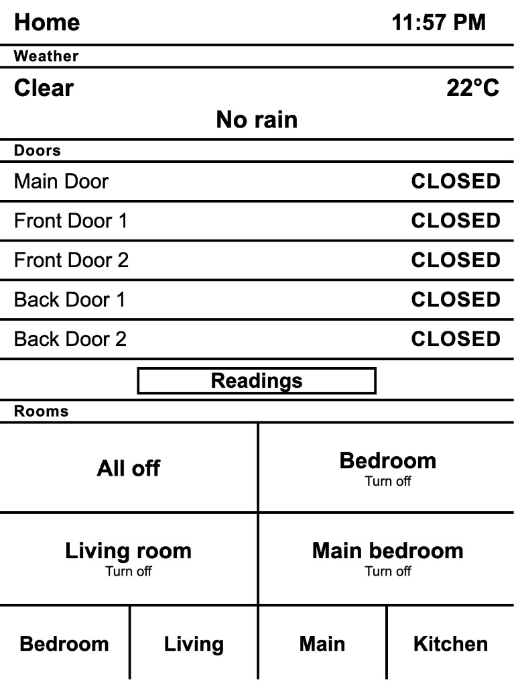

# kindle_home_assistant

A black-and-white Home Assistant screen for a Kindle. `door_board.py` renders plain HTML sized for the Kindle browser and talks to Home Assistant with a long-lived token.

The page is 600×794, refreshes every 10 seconds, and uses only links so it works in the old Kindle browser.



## Home screen

- **Weather** shows the current condition and a rain line. If rain is expected in the next 24 hours, that line turns black and shows the time.
- **Doors** lists each door as open or closed, with temperature, humidity, and battery. An open door is a black row.
- **Rooms** runs the turn-off scripts: All off, Bedroom, Living room, and Main bedroom. These stay white so they do not look like an open door.
- The bottom row opens Bedroom, Living, Main, and Kitchen. Each room is a page of on/off buttons. A control is black while it is on.

## Run

The server listens on port 8787. It reads the Home Assistant token from `/etc/door-board/token` and uses the Home Assistant URL set at the top of `door_board.py`.

```sh
python3 door_board.py
```

Only the lights, fans, and switches listed in the script can be toggled. Turn-off buttons call these Home Assistant scripts:

- `script.all_off`
- `script.bedroom_turn_off_script`
- `script.living_room_turn_off_script`
- `script.main_bedroom_turn_off_script`

## Kindle

Open `http://<door-board-host>:8787/` in the Kindle browser after the Kindle interface is stopped, so the page is fullscreen. The bottom button reboots the Kindle back to the home screen. A hardware refresh keeps the e-ink text sharp.
